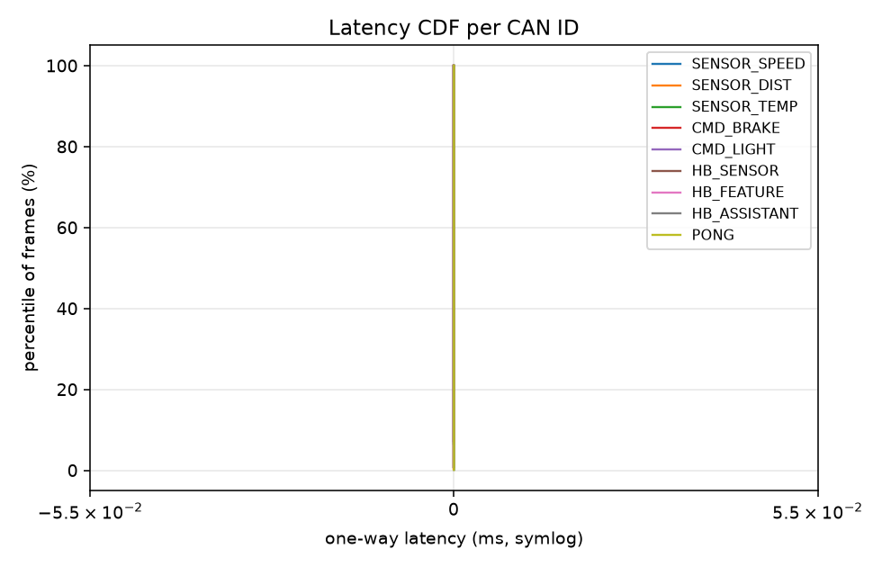
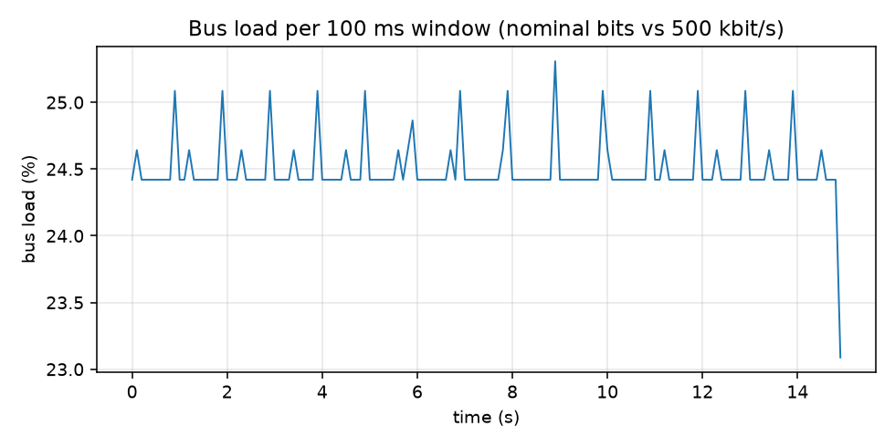
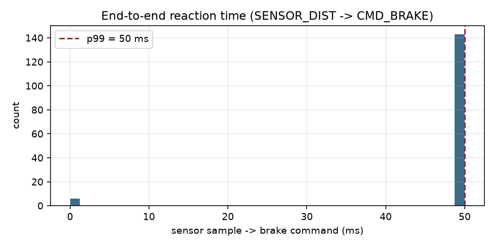

# vECU-Bench

[](https://github.com/ychong0711-ops/vecu-can-bench/actions/workflows/ci.yml)

**A virtual ECU network testbed on Linux SocketCAN for measuring CAN latency,
frame loss and bus load — with automated regression testing.**

Built as a hands-on portfolio project for automotive embedded software:
three cooperating virtual ECUs (sensor → control logic → actuator, modeled
after a classic AUTOSAR demo vehicle), a passive measurement node, a
deterministic bus-load injector, `tc/netem`-based fault injection, a pytest
regression suite (functional + performance thresholds) running in CI, and a
Python analysis stage producing percentile statistics, plots and reports.

On top of that measurement core the control ECU is **layered AUTOSAR-style
(SWC / RTE / driver, statically gated)** and the verification story is
quantitative: **seeded-bug mutation testing (14/14 detected = 100 %)** plus
**HIL-style scenario replay with timing properties** — see
[Verification hardening](#verification-hardening-track-a).

```
                    vcan0  (virtual CAN bus, modeled @ 500 kbit/s)
   ┌───────────┬────────────┬───────────────┬────────────┬───────────┐
   │ ecu_sensor│ ecu_feature│ ecu_assistant │  injector  │  monitor  │
   │ 20/50/100 │  brake &   │ actuators +   │ deterministic│ passive │
   │ ms periodic│ light ctrl│ PING→PONG echo│ load gen   │ recorder  │
   └───────────┴────────────┴───────────────┴────────────┴───────────┘
        │  SENSOR_* 0x100-0x102   │  CMD_* 0x200/0x201        │ CSV+JSON
        └────────────────────────┴───────────────────────────►│ analysis/
                     tc/netem: delay · jitter · loss          ▼
                                              reports/ (stats, plots, report.md)
```

## Measured results at a glance

Measured on WSL2 (kernel 6.18, vcan0) — every number is reproducible via the
commands linked in [Verification hardening](#verification-hardening-track-a):

| Result | Value | Source |
|---|---|---|
| Mutation score (seeded bugs) | **14/14 = 100 %** (gate ≥ 90 %) | `make mutation` |
| HIL scenario runs clean | **24/24** (P1/P2/P3 timing properties) | `pytest tests/test_hil_replay.py` |
| Regression suite | 24 passed + 1 skipped (pre-Track-A baseline: 14) | `make test` |
| E2E sensor→brake reaction (p99) | **50 ms** — the `SENSOR_DIST` sample period; the SrcSeq join is quantized per sample (15 s CI demo, n=149) | CI demo run (images below) |
| One-way latency p99 under 40 % load | < 20 ms asserted, CI-enforced | `make test` |
| Frame loss | 0 lost on idle bus and in the 25 %-load demo; < 0.5 % asserted @ 40 % | `make test`, demo run |

From the CI demo run shown above (15 s, 20 % target load, 16 550 frames,
zero loss). Left: one-way latency CDF (p99 ≤ 1 ms); middle: bus load with
the injector's ±1 % band; right: sensor→brake end-to-end reaction. A full
machine-readable version of the mutation run is in
[`docs/mutation-report.md`](docs/mutation-report.md).

  

## What is measured

## What is measured

| Metric | Method |
|---|---|
| One-way latency | every frame embeds `[seq u16][tx_ms u32][value u16]`; monitor computes `rx_ms − tx_ms` (same `CLOCK_MONOTONIC` host) and reports p50/p95/p99/max per CAN ID |
| Frame loss | 16-bit sequence-gap counting per ID (wrap-safe, reorder-tolerant) |
| Round-trip time | monitor sends `PING 0x500`, assistant echoes `PONG 0x501` verbatim |
| Bus load | nominal frame bits `47 + 8·dlc` vs 500 kbit/s, 1-s windows (avg + max); worst-case stuffing bits also accumulated |
| End-to-end reaction | `SENSOR_DIST` seq (low byte) is carried in `CMD_BRAKE.SrcSeq` → sensor-sample-to-brake-command chain latency incl. the 100 ms control cycle |
| Scheduling jitter | each node tracks `max_late` per periodic task (deadline vs. actual start) |

## Quickstart

```bash
# requires: Linux (native/VM) with the vcan module, gcc, make, python3
sudo modprobe vcan
./scripts/setup_vcan.sh          # creates vcan0

# on a stripped image (e.g. GitHub's ubuntu-latest) the CAN modules are not
# installed — this adds linux-modules-extra-$(uname -r) first, then vcan0:
sudo ./scripts/ci_setup_vcan.sh
make                             # builds bin/{ecu_sensor,ecu_feature,ecu_assistant,monitor,injector}

# AddressSanitizer + UBSan build (separate output dir: bin-asan/)
make asan

# Static analysis (requires cppcheck: sudo apt-get install cppcheck)
make lint                        # cppcheck + layering gate (Track A)

# Track A verification: seeded-bug mutation run (gate: detection >= 90 %)
make mutation                    # -> reports/mutation/mutation.{json,md}

# HIL-style scenario replay: timing properties on the real control ECU
./bin/ecu_feature --duration 8 &
python3 scripts/replay.py --scenario replay/scenarios/approach_brake.yaml
python3 scripts/replay.py --from-frames reports/demo/frames.csv   # replay a recording

# Regenerate & verify ID map from DBC (single source of truth)
python3 scripts/gen_idmap.py
python3 scripts/gen_idmap.py --check

# 20 s full-stack demo with 20 % background load + report generation
./scripts/run_demo.sh            # -> reports/demo/{frames.csv,summary.json,analysis.json,report.md,*.png}

# full experiment matrix (baseline / load 20,50 % / netem delay,loss / combo)
./scripts/run_matrix.sh          # -> reports/<scenario>/... + reports/matrix/matrix.md

# regression suite (functional logic + performance thresholds on live vcan)
pip install -r requirements.txt   # pytest, pandas, numpy, matplotlib, tabulate, cantools
make test
```

> **⚠️ WSL2 Limitation: Integration Tests Require `vcan`**
>
> **Stock WSL2 kernels do not include the `vcan` kernel module.** The integration test suite (`make test`) and demo scripts (`run_demo.sh`, `run_matrix.sh`) **only run in GitHub Actions CI** (see `.github/workflows/ci.yml`), where `vcan` is available.
>
> **To run locally, use one of:**
> - **Native Linux** (recommended)
> - **Virtual Machine** — VirtualBox, VMware, or similar with a standard Linux distro
> - **WSL2 with a custom kernel** that enables `CONFIG_VCAN=m` (see [WSL kernel build guide](https://learn.microsoft.com/en-us/windows/wsl/use-custom-kernel))

## Repository layout

```
include/common.h     IDs, measured-frame layout, bit formulas, node API
include/swc_brake.h  SWC layer: pure control logic (no OS/CAN headers, gated)
include/rte_feature.h RTE layer: port struct + Rte_Read_/Rte_Write_ accessors
src/can_util.c       SocketCAN open/bind/send, payload packing
src/sched.c          cooperative periodic-task loop (select + deadlines)
src/ecu_sensor.c     simulated speed/distance/temperature publisher
src/ecu_feature.c    driver/composition: rx → RTE, 100 ms runnable, transmit
src/swc_brake.c      SWC implementation — the mutation-testing target
src/ecu_logic.c      compat FFI shim keeping the ctypes unit tests stable
src/ecu_assistant.c  actuator simulation + PING/PONG echo
src/monitor.c        passive recorder: CSV, per-ID loss/latency, bus load, JSON summary
src/injector.c       target-% bus-load generator (absolute-deadline pacing)
dbc/vecu.dbc         signal database (cantools-compatible, validated in CI)
mutation/seeds.yaml  15 seeded bugs + scripts/mutate.py runner (mutation score)
replay/scenarios/    scripted sensor timelines + scripts/replay.py properties
scripts/             vcan setup/teardown, netem presets, id map, layering gate,
                     mutation & replay runners
tests/               pytest: DBC, control logic (SWC), HIL replay, echo, loss/RTT/load
analysis/analyze.py  CSV → percentile stats, latency CDF, bus-load series, E2E join, matrix compare
```

## Test matrix (CI-enforced)

| Test | Asserts |
|---|---|
| `test_dbc_matches_id_map` | DBC parses (cantools) and mirrors `common.h` |
| `test_feature_brake_logic` | dist=100 cm → brake>50 %; dist=1800 cm → brake released |
| `test_assistant_pong_echo` | PONG preserves seq + tx timestamp |
| `test_baseline_zero_loss` | zero frames lost on idle bus (0x100/0x101/0x102/0x200/0x201) |
| `test_ping_rtt_low` | RTT p99 < 10 ms |
| `test_busload_accuracy` | injector @25 % measures within 21–29 % |
| `test_latency_under_load` | @40 % load: SENSOR_DIST p99 < 20 ms, loss < 0.5 % |
| `test_netem_delay_visible` | netem 10 ms±2 ms shows up as RTT p50 ≥ 15 ms |
| `test_logic.py` (7) | SWC unit suite via FFI: ramp/clamp boundaries, stale inputs, hazard priority, seq wrap, pack/unpack roundtrip, umbrella runnable |
| `test_hil_replay.py` (9) | HIL replay: P1/P2/P3 on live vcan (3 scenarios + stalled-sensor liveness), silent-ECU violation (checker confidence), 4 deterministic property tests |

## Verification hardening (Track A)

The control ECU is **layered** (SWC / RTE / driver, one-way dependency) and
verified on three independent levels. Design details: `docs/ARCHITECTURE.md` §8.
All numbers below are measured on WSL2 (kernel 6.18, vcan0).

| Gate | Command | Measured result |
|---|---|---|
| Layering gate | `make lint` (cppcheck + `scripts/check_layering.py`) | include allowlist enforced for `swc_brake.{h,c}` / `rte_feature.h`; violation injected in a negative test → gate fails with `file:line` |
| Mutation testing | `make mutation` | **14/14 seeds detected (100 %)** + 1 verified equivalent mutant, ≈ 75 s serial (69–81 s measured) / 22 s with `--jobs 4` |
| HIL replay | `pytest tests/test_hil_replay.py` | timing properties P1/P2/P3 clean on **24/24 scenario runs** (6 iterations × 4 scenarios) |
| Regression suite | `make test` | **24 passed + 1 skipped** (netem probe) — was 14 passed + 1 skipped before Track A |

```
driver  src/ecu_feature.c      rx → Rte_Write_Sensor* · 100 ms runnable · transmit
  │  (composition root: frame I/O + periodic scheduling only)
  ▼
RTE     include/rte_feature.h  rte_feature_t port + Rte_Read_/Rte_Write_ accessors
  │
  ▼
SWC     include/swc_brake.h    swc_brake_compute() + granular API (pure, stdint only)
        src/swc_brake.c        ← the mutation-testing target
```

**Findings produced by the verification loop** (each became a seed, a test or a
rule — the interesting part is that three of them were *harness* defects that
would have made the verification meaningless):

1. **Dead code / equivalent mutant** — the `b > 100` clamp branch is unreachable
   (`dist < 300 ⇒ b ≤ 100`), so one seed survived; the runner now verifies
   equivalence claims mechanically instead of assuming them.
2. **Coverage gap** — the A1 umbrella runnable `swc_brake_compute()` had no FFI
   coverage; two seeds aimed at it survived until the umbrella test existed.
3. **Vacuous checker** — the replay socket must self-receive its injected
   `SENSOR_DIST` frames (`CAN_RAW_RECV_OWN_MSGS`), otherwise P1 has no input and
   passes trivially (a check that cannot fail is worthless).
4. **Property false positive** — the literal P1 wording flagged correct
   behaviour when an obstacle cleared inside one command period (2 of 3 runs);
   P1 is now state-based ("already braking, or braking starts within the
   budget") and pinned by deterministic unit tests.

**Reproduce**

```bash
make && make lint && make test     # build, gates, regression suite
make mutation                      # mutation score -> reports/mutation/
./bin/ecu_feature --duration 8 &   # ECU under test
python3 scripts/replay.py --scenario replay/scenarios/emergency_brake.yaml
```

CI (`.github/workflows/ci.yml`) runs the same gates as five jobs —
`build-and-test` (pytest on live vcan + demo + analysis), `qa` (cppcheck,
layering gate, DBC/id-map), `test-asan`, `mutation` and `hil-replay` — and
uploads each report as an artifact. Reaching all-green took three
runner-specific fixes worth knowing when reproducing on a stripped image:
shell scripts must be committed executable (`100755`, they were `100644` from
a Windows checkout), GitHub's images ship **no CAN kernel module**
(`scripts/ci_setup_vcan.sh` installs the matching `linux-modules-extra` first),
and scenario runs must not require privileges once the interface already exists
(the demo died on `ip link set up` with `EPERM`).

## Measurement methodology & limitations

* vcan does **not** simulate bit timing, arbitration or error frames — bus load
  is computed against a nominal 500 kbit/s reference, and latency figures
  reflect kernel queueing/scheduling, not wire propagation. This is a
  *functional + system-level* testbed; for bit-accurate behavior, pair it with
  hardware (e.g. PCAN/SocketCAN adapter) using the same tooling.
* All nodes share one host clock (`CLOCK_MONOTONIC`), so one-way latency from
  the embedded `tx_ms` is exact (no clock-sync error) — but only valid
  single-host. The PING/PONG RTT path additionally validates the monitor.
* `tc/netem` on **vcan** shapes only the real frame behind the socket-layer
  loopback clone that receivers actually see — so delay/loss presets are a
  **no-op for same-host delivery** (verified: `netem loss 100%` still delivered
  every frame; `delay 500ms` measured 0.05 ms). The scenario matrix's
  `delay*`/`loss*` cells therefore show no delta on vcan; netem becomes
  meaningful when swapping in a real adapter transmitting across hosts
  (`tests/test_performance.py::test_netem_delay_visible` probes this and
  skips with the reason when ineffective).

## Extension tracks

Three deepening tracks are documented in `docs/ARCHITECTURE.md` §7.
**(a)** ECU-verification emphasis — layered SWC/RTE-like architecture, mutation
testing, HIL-style replay — is **implemented** (see the section above and
`docs/ARCHITECTURE.md` §8). **(b)** real-time/systems analysis (formal timing
properties, RM utilization vs. measured response times, trace anomaly
detection) and **(c)** timing-analysis emphasis (WCRT estimation, jitter
decomposition, worst-case scenario search) remain open candidates.

## License

MIT — see [LICENSE](LICENSE).
