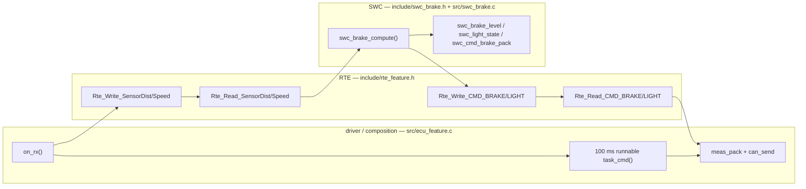

# vECU-Bench — Architecture & Design Notes

## 1. Design goals

1. A **real running ECU network** (3 cooperating nodes) instead of a mock-up,
   so every claim in a report is backed by measured data.
2. **Industry-shaped artifacts**: DBC signal database, periodic task model,
   seq/timestamp framing, regression thresholds in CI — the vocabulary ECU
   teams use.
3. **Reproducible measurements**: one command re-runs any scenario and
   regenerates statistics + plots.
4. **Honest scope**: vcan limitations are documented, not hidden (§6).

## 2. Node model

Every node is a single-threaded C program: a `select()` loop wakes on
(a) incoming CAN frames and (b) the earliest periodic-task deadline.
Tasks run cooperatively; each task records its worst lateness
(`max_late`) — the scheduling-jitter metric.

| Node | Role | Periodic tasks | Reactive |
|---|---|---|---|
| `ecu_sensor` | publish simulated vehicle state | speed 20 ms, dist 50 ms, temp 100 ms, hb 1 s | — |
| `ecu_feature` | control logic (layered, see §8) | cmd 100 ms, hb 1 s | caches SENSOR_* on rx |
| `ecu_assistant` | actuators + probe target | hb 1 s, status 2 s | CMD_* → actuator state; PING → PONG |
| `monitor` | measurement | optional PING every N ms | records **all** frames |
| `injector` | load generation | 1 ms pacing tick | — |

Control law (demo): `brake = clamp((300 − dist_cm)/3, 0..100)` when
`dist < 300 cm`; `light = hazard` if `dist < 150`, `low beam` if `speed > 70 km/h`.

## 3. Measured-frame layout (classic CAN, dlc = 8)

```
byte:  0    1    2    3    4    5    6    7
      [ seq u16  ] [ tx_ms u32 (CLOCK_MONOTONIC & 0xFFFFFFFF) ] [ value u16 ]
```

* `seq` — per-ID counter → loss via wrap-safe gap counting
  (`d = (seq − last − 1) mod 2^16`; counted only when `0 < d < 2^15`,
  so late duplicates are ignored, not misread as loss).
* `tx_ms` — sender timestamp; monitor's one-way latency is
  `(rx_ms − tx_ms) mod 2^32`, exact because both come from the same host clock.
  Samples ≥ 60 s are discarded as implausible (`lat_dropped`).
* `value` — application signal per DBC. `CMD_BRAKE` packs
  `(SrcSeq8 << 8) | BrakeLevel`, where `SrcSeq8` is the low byte of the
  triggering `SENSOR_DIST` seq → enables the **end-to-end reaction-time**
  join in analysis (sensor sample → brake command on the bus).

## 4. Bus-load accounting

Nominal bits of a CAN 2.0A data frame: `47 + 8·dlc`
(SOF+ID+ctrl+CRC+ACK+EOF+IFS = 47). Worst-case bit stuffing adds
`floor((34 + 8·dlc − 1)/4)`; the monitor accumulates both.
`load% = bits / (500 kbit/s × window)`. The injector inverts the formula to
hit a target load: `fps = pct/100 × 500000 / (47 + 8·dlc)`, paced on absolute
1 ms deadlines with fractional-remainder carry (long-run accurate).

## 5. Data flow

```
nodes ──(vcan0)──► monitor ──► frames.csv (rx_us,id,dlc,seq,tx_ms,lat_ms,val)
                        └────► summary.json (machine-readable, used by pytest)
frames.csv ──► analysis/analyze.py ──► analysis.json, report.md,
                                       latency_cdf.png, bus_load.png, e2e_reaction.png
run_matrix.sh ──► reports/<scenario>/… ──► analyze.py --matrix ──► matrix.{csv,md}, matrix_rtt.png
mutation/seeds.yaml ──► scripts/mutate.py ──► reports/mutation/mutation.{json,md}   (§8.3)
replay/scenarios/*.yaml ─┐
frames.csv (replay source) ─┴► scripts/replay.py ──► reports/replay/<name>.json    (§8.4)
```

## 6. Validity & limitations (read before quoting numbers)

* **vcan is a kernel software bus**: no bit timing, no arbitration, no error
  frames, no wire propagation. Absolute latency numbers are *system-level*
  (scheduling + queueing) figures, not wire figures. Rankings and regressions
  remain meaningful; for bit-accurate work swap vcan for a real adapter
  (PCAN/PEAK, Kvaser, SocketCAN-compatible) — no code changes needed.
* One-way latency relies on a **shared host clock** — valid single-host only.
  The PING/PONG RTT path is the clock-independent cross-check.
* `tc/netem` shapes the TX qdisc, but same-host vcan receivers get frames via
  a socket-level loopback clone (vcan has no IFF_ECHO) that **bypasses the
  qdisc**; the delayed real frame reaches the driver, which does not
  re-deliver it. Measured: `loss 100%` still delivered every frame and
  `delay 500ms` yielded 0.05 ms delivery. Consequences:
  (i) disabling `CAN_RAW_LOOPBACK` breaks delivery outright (TX counters move,
  rx = 0 — measured), so it must stay on; (ii) netem `delay`/`loss` scenarios
  are a no-op for same-host vcan runs (the matrix keeps them for CI structure,
  but they should not be quoted as fault-injection results); (iii) netem only
  becomes meaningful with a real adapter transmitting to other hosts, where
  the driver TX path goes through the qdisc on the wire. The `test_netem_delay_visible`
  probe skips with this reason when shaping has no observable effect.
* Receive buffers are enlarged (4 MB, `SO_RCVBUFFORCE` when permitted) and
  `txqueuelen` raised by `setup_vcan.sh` to avoid measurement artifacts under
  high injected load; ENOBUFS on tx is counted by the injector, not hidden.

## 7. Extension tracks (pick one to deepen)

### (a) ECU-verification track  *(automotive SW engineering flavor)* — **implemented, §8**
* ✅ Refactor `ecu_feature` into layers: SWC (pure logic, unit-testable) /
  RTE-like interface structs / CAN driver — mirrors AUTOSAR layering,
  enforced by a static layering gate (`scripts/check_layering.py`).
* ✅ **Mutation testing**: 15 seeded bugs in `mutation/seeds.yaml` applied to
  tree copies by `scripts/mutate.py`; the suite detected 14/14 scorable seeds
  (100 %) and one verified equivalent mutant.
* ✅ HIL-style **scenario replay**: `scripts/replay.py` replays scripted sensor
  timelines onto vcan0 and checks timing properties P1/P2/P3 on the observed
  actuator traffic (`replay/scenarios/`, `tests/test_hil_replay.py`).

### (b) Real-time / systems-analysis track  *(CPS/verification flavor)*
* Write the **timing contract** as a table (period, deadline, WCET estimate)
  and check measured response times + `max_late` jitter against it.
* Rate-monotonic analysis: compute utilization `U = Σ Ci/Ti`, compare the
  Liu–Layland bound with measured schedulability under injected load.
* Trace **anomaly detection**: statistical baseline (mean/σ of inter-arrival
  per ID) → deviation alarms → simple runtime-verification properties
  ("CMD_BRAKE must follow SENSOR_DIST < 300 cm within 2 cycles").

### (c) Timing-analysis track  *(WCRT/OS flavor)*
* Decompose RTT into components (node wakeup, handler, qdisc, monitor) via
  extra timestamps; publish a jitter budget.
* **Worst-case scenario search**: sweep `(load %, netem delay, loss)` grid,
  record p99.9/max RTT per cell → heat map of worst-case behavior
  (measurement-based whole-system timing analysis, in the spirit of
  fuzzing-based approaches like FRET [RTSS '25]).
* Compare measurement-based WCRT with a compositional estimate
  (per-stage budgets summed) and discuss the gap.

## 8. Track A — verification hardening (implemented)

Extension track (a) was implemented end-to-end: layered control software,
a static layering gate, seeded-bug mutation testing and HIL-style scenario
replay with timing properties.

### 8.1 Layering: SWC / RTE / driver (one-way dependency)

`ecu_feature` is split into three layers; the dependency direction is
driver → RTE → SWC, and it is **checked statically** by
`scripts/check_layering.py` (allowlist of `#include` basenames per gated
file), wired into `make lint` and therefore into the CI `qa` job.



Execution per cycle (no logic outside the SWC):

```
CAN rx (driver)  ─► Rte_Write_Sensor*        ── observations into the RTE port
100 ms runnable  ─► Rte_Read_Sensor* ─► swc_brake_compute() ─► Rte_Write_CMD_*
driver transmit  ─► Rte_Read_CMD_* ─► meas_pack() ─► can_send()   (frame I/O only)
```

| Layer | Files | Allowed includes | Forbidden |
|---|---|---|---|
| SWC | `include/swc_brake.h`, `src/swc_brake.c` | `stdint.h`, `stddef.h`, own header | any OS/CAN/RTE/driver header |
| RTE | `include/rte_feature.h` | `stdint.h`, `stddef.h` | OS/CAN/SWC headers |
| driver | `src/ecu_feature.c` | `common.h`, RTE + SWC headers | — (composition root) |

`include/ecu_logic.h` + `src/ecu_logic.c` remain as a **compat shim** for the
ctypes unit tests: the legacy `feature_*`/`ecu_logic_*` names now delegate to
the SWC layer, so no test call site had to change beyond the build inputs.

The gate was negative-tested: injecting `#include <linux/can.h>` (or
`<sys/socket.h>`) into `src/swc_brake.c` makes `python3 scripts/check_layering.py`
exit non-zero with a `file:line` report, and `make lint` fails with it.

### 8.2 Behaviour preservation

The refactor is bit-identical to the pre-A1 baseline: the same frame cadence,
the same `CMD_BRAKE = (SrcSeq8 << 8) | BrakeLevel` packing and the same
clamp/priority trees — verified by the unchanged live-CAN regression test
(`tests/test_functional.py::test_feature_brake_logic`) plus the SWC unit suite.

### 8.3 Mutation testing (seeded bugs) — measured

`mutation/seeds.yaml` holds 15 seeds (arithmetic, threshold off-by-one,
boundary flip, guard removal, priority inversion, E2E pack/unpack) and
`scripts/mutate.py` copies the tree, applies one exact-text mutation, builds
and runs the selected suite. Measured on WSL2 (kernel 6.18, vcan0):

| Quantity | Value |
|---|---|
| seeds | 15 (14 scorable + 1 equivalence-checked) |
| detected / survived | **14 / 0** → **mutation score 100 %** (gate ≥ 90 %) |
| runtime | ≈ 75 s serial (measured 69–81 s) · 22 s with `--jobs 4` (bus-free selection) |

Two findings came out of the first runs and are documented in
`mutation/README.md`: (i) one survivor was an **equivalent mutant** — the
`b > 100` clamp branch is unreachable because `dist < 300 ⇒ b ≤ 100`
(dead code), now encoded as `equivalent: true` and machine-verified by the
runner; (ii) the A1 umbrella runnable `swc_brake_compute()` had **no FFI
coverage**, so two seeds targeting it survived until
`test_compute_umbrella_matches_granular` was added.

### 8.4 HIL-style scenario replay + timing properties — measured

`scripts/replay.py` is a Python-only replay node (decision: no C replay binary):
it injects a sensor timeline (scenario YAML) or a monitor recording
(`--from-frames`) onto vcan0 and checks the observed actuator traffic against:

| Property | Statement | Budget |
|---|---|---|
| P1 brake_response | a `SENSOR_DIST < 300` observation is braked — either already active at that moment or starting within the budget | 300 ms |
| P2 brake_release | `brake > 0` while the whole preceding window is `SENSOR_DIST ≥ 300` (and the window is fully observed) | 300 ms |
| P3 cmd_liveness | `CMD_BRAKE` inter-frame gaps stay bounded (also during a stalled sensor) | 250 ms |

Scenarios: `cruise`, `approach_brake`, `emergency_brake`, `sensor_stall`
(stale-data path). The checker is verified from both sides — the replay suite
includes a deliberately violating run (no ECU → P1+P3 must fire) and four
deterministic property unit tests. Measured: 24/24 scenario runs clean
(6 iterations × 4 scenarios), 9 replay tests in `tests/test_hil_replay.py`.

Design note (documented in `replay/README.md`): the socket enables
`CAN_RAW_RECV_OWN_MSGS` **on purpose** — without self-reception the checker
would never see the injected `SENSOR_DIST` observations and P1 would pass
vacuously. The literal P1 wording ("a new `CMD_BRAKE > 0` within 300 ms")
intermittently flagged *correct* behaviour (2 of 3 runs) when the obstacle
cleared inside one command period; the state-based formulation above removed
the false positives while keeping the strictness test intact.

### 8.5 Reproduce

```bash
make                              # build
python3 -m pytest tests/ -v       # 24 passed + 1 skipped (incl. HIL replay)
make mutation                     # 15 seeds -> reports/mutation/mutation.{json,md}
python3 scripts/replay.py --scenario replay/scenarios/emergency_brake.yaml
python3 scripts/replay.py --from-frames reports/demo/frames.csv
python3 scripts/check_layering.py # layering gate (also part of `make lint`)
```

## 9. References

* SocketCAN: Linux kernel `Documentation/networking/can.rst`; `man 7 netdevice`
* CSS Electronics, *CAN bus explained* (frame format, bit stuffing)
* cantools (DBC parsing), pytest, pandas/matplotlib
* Liu & Layland, *Scheduling Algorithms for Multiprogramming in a Hard-Real-Time
  Environment* (1973) — RM bound
* Berger et al., *Dynamic Fuzzing-Based Whole-System Timing Analysis*, IEEE RTSS 2025
